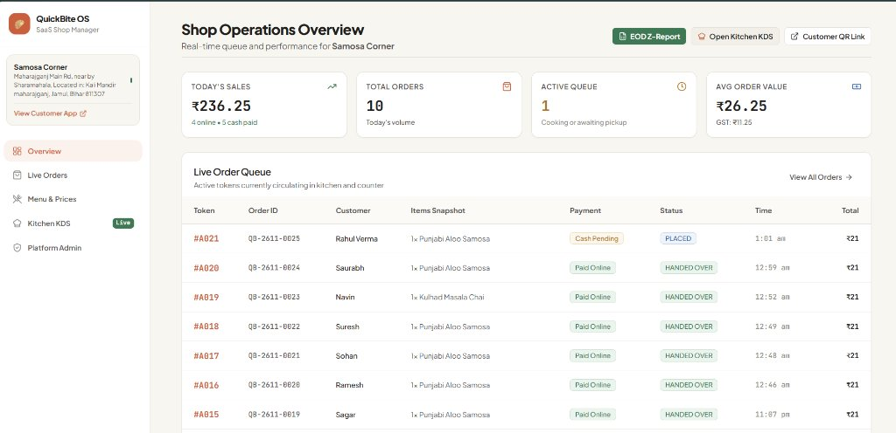
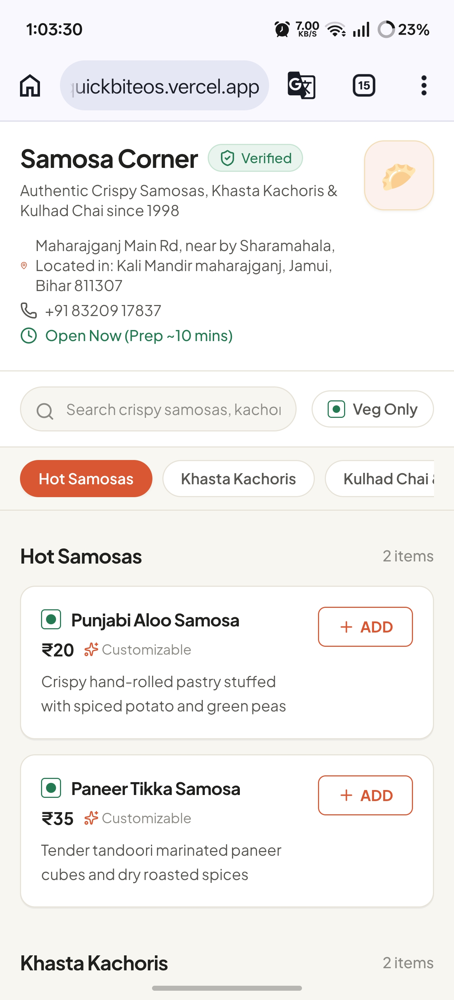
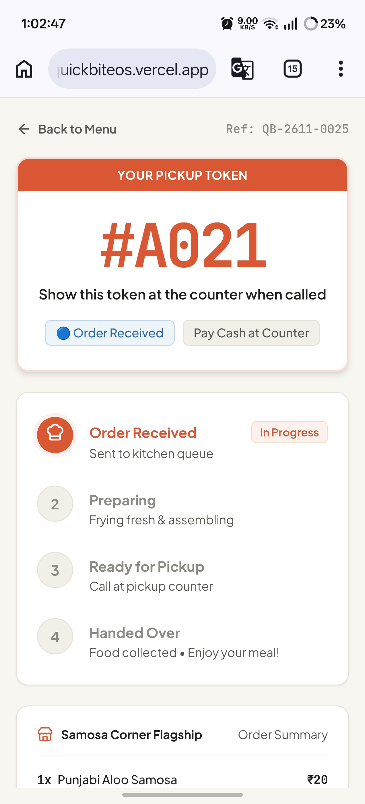
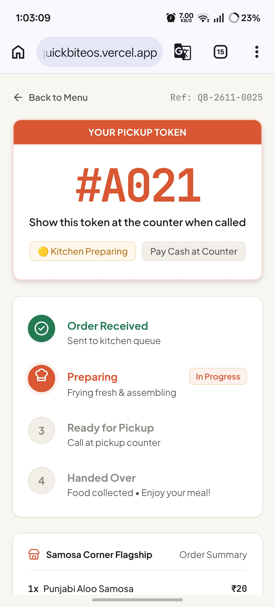
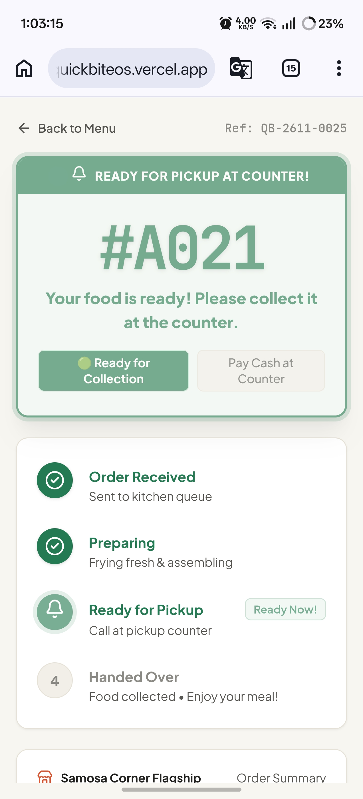
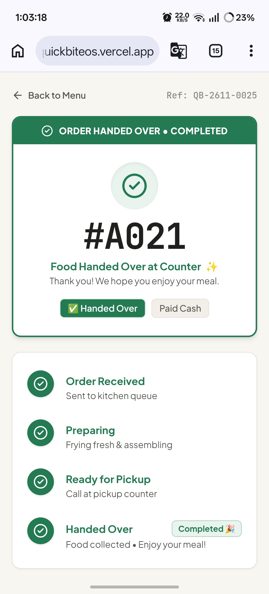
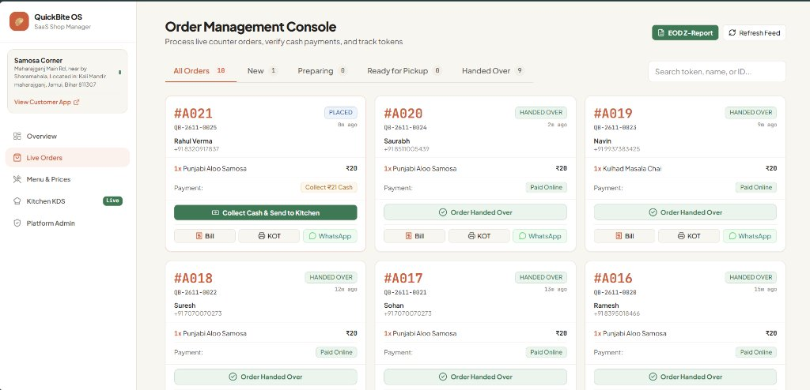
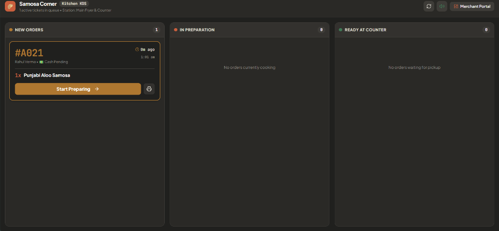
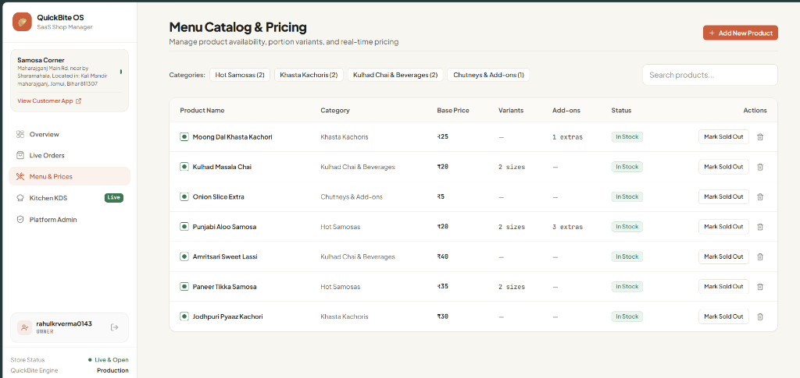

# QuickBite OS 🥟
> **Modern Multi-Tenant Food Ordering, Payment, Real-Time Pickup-Token & QSR Operations SaaS**

[](https://www.typescriptlang.org/)
[](https://react.dev/)
[](https://vitejs.dev/)
[](https://tailwindcss.com/)
[](https://supabase.com/)
[](https://razorpay.com/)
[](https://vitest.dev/)

---



QuickBite OS is an all-in-one digital ordering and restaurant management platform engineered for food enterprises across India — ranging from single-stall street food vendors (samosa, kachori, and chai stalls) to multi-outlet quick service restaurants (QSRs), bakeries, and cafes.

---

## 📸 Product Tour & Live System Screenshots

### 1. Customer Mobile Experience (Scan QR & Instant Track)
*Zero-install progressive web application. Fast loading on 4G networks with real-time pickup token allocation and live preparation progress.*

| 1. Digital Menu | 2. Token Allocated | 3. Cooking in KDS | 4. Counter Pickup | 5. Completed |
| :---: | :---: | :---: | :---: | :---: |
|  |  |  |  |  |

---

### 2. Live Order Management Console & Cashier POS
*One-click cash collection, ticket generation, thermal receipt/KOT printing, and customer WhatsApp messaging.*



---

### 3. Kitchen Display System (KDS)
*High-contrast 3-stage dark Kanban board for kitchen stations with Web Audio alert chimes, overdue rush priority, and dedicated WhatsApp pickup notifications.*



---

### 4. Menu Catalog & Real-Time Dynamic Pricing
*Manage item availability (In Stock / Sold Out), portion variants, and live prices with immediate WebSocket propagation across all customer and staff screens.*



---

## 🌟 Core Architectural Capabilities

### 📱 Frictionless Customer Experience
- **Instant QR Code Ordering:** Customers scan a counter or table QR code to open the digital menu (`/shop/:slug`) with sub-1.5s load times.
- **No App Download Required:** Add items to cart, enter name and mobile number, and pay via UPI or Cash at Counter.
- **Cryptographic Order Tracking:** Live tracking page (`/order/:secureAccessToken`) featuring real-time status progression, estimated preparation countdown, and atomic pickup tokens (e.g. `#A001`, `#A002`).

### 🍳 Dedicated Kitchen Display System (KDS)
- **3-Stage Kitchen Board (`/kitchen`):** High-contrast dark board tracking **New / Placed**, **Preparing**, and **Ready at Counter**.
- **Real-Time Web Audio Chimes:** Synthesized audio chimes automatically sound whenever a new order is received or payment confirms.
- **Order Aging Indicators:** Visual time tags showing exact elapsed cooking time to prevent delays.
- **Granular Actions:** Distinct `Mark Ready` status transition with optional dedicated WhatsApp ping button and thermal ticket printing.

### 💼 Cashier Operations & Settlement
- **Cash Counter Verification:** 1-click cash collection that transitions orders to `PAID` and routes tickets directly to the kitchen in real time.
- **Thermal KOT & Receipt Printing:** One-click ESC/POS thermal printing for 58mm & 80mm Bluetooth/USB printers.
- **WhatsApp Customer Ping:** Direct WhatsApp Web / App API deep-link to notify customers when food is ready.
- **End-of-Day (EOD) Z-Report:** Financial settlement calculation respecting the Indian QSR **4:00 AM IST cutoff rule**, summarizing cash vs. online UPI totals, GST collected, and top-selling items with CSV export.

### 🔒 Enterprise Multi-Tenant Security & Integer Paisa Precision
- **PostgreSQL Row Level Security (RLS):** Strict multi-tenancy enforced at the database level with `get_auth_business_id()` verification.
- **Server-Authoritative Integer Paisa:** Zero floating-point monetary bugs. All monetary amounts, taxes, and prices are strictly calculated in **integer paisa** ($1\text{ INR} = 100\text{ paisa}$).
- **Hardened Access Control:** Revoked anonymous execution privileges on all merchant and administrative stored procedures.
- **HTML Sanitization:** Protection against cross-site scripting (XSS) across thermal print outputs and Z-reports.

---

## 🚀 Tech Stack

| Layer | Technologies |
| :--- | :--- |
| **Frontend** | React 19, TypeScript, Vite, Tailwind CSS v4, React Router 7 |
| **State Management** | Zustand (persistent cart), TanStack React Query |
| **Typography & UI** | Playfair Display, Plus Jakarta Sans, JetBrains Mono, Lucide Icons |
| **Database & Auth** | Supabase PostgreSQL 17, Row Level Security (RLS), Realtime Broadcast |
| **Payment Gateway** | Razorpay (UPI, Credit/Debit Cards, NetBanking) with HMAC-SHA256 verification |
| **Testing & Quality** | Vitest (93 automated unit & regression tests), Oxlint |

---

## 🗺️ Application Routes

| Route | Access Level | Description |
| :--- | :---: | :--- |
| `/shop/:slug` | **Public** | Customer digital ordering menu (e.g. `/shop/samosa-corner`) |
| `/order/:secureAccessToken` | **Public** | Cryptographic customer order tracking & live pickup token |
| `/login` | **Public** | Staff and merchant authentication portal |
| `/dashboard` | **Protected** | Merchant analytics overview & performance stats |
| `/dashboard/orders` | **Protected** | Live Order Management Console & Cashier POS terminal |
| `/dashboard/menu` | **Protected** | Menu Catalog, Price Overrides & Stock Management |
| `/kitchen` | **Protected** | Dedicated Kitchen Display System (KDS) for kitchen tablets |
| `/platform-admin` | **Protected** | Fleet Management for multi-outlet platform administration |
| `/*` | **Public** | Custom "Lost in the Sauce" 404 Error Experience |

---

## 📦 Getting Started

### 1. Prerequisites
- [Node.js](https://nodejs.org/) (v18 or later)
- npm (v9 or later)

### 2. Clone and Install
```bash
git clone https://github.com/rahulkrvermaa/QuickBiteOS.git
cd QuickBiteOS
npm install
```

### 3. Environment Variables
Copy the example environment configuration to `.env.local`:
```bash
cp .env.example .env.local
```

Configure your variables in `.env.local`:
```env
VITE_APP_NAME="QuickBite OS"
VITE_APP_URL="http://localhost:5173"

# Supabase Credentials (from your Supabase Project Settings -> API)
VITE_SUPABASE_URL="https://your-project.supabase.co"
VITE_SUPABASE_ANON_KEY="your-anon-public-key"

# Razorpay Client ID
VITE_RAZORPAY_KEY_ID="rzp_test_..."
```

### 4. Run Development Server
```bash
npm run dev
```
Open [http://localhost:5173](http://localhost:5173) in your browser.

---

## 🧪 Testing & Code Quality

QuickBite OS includes a comprehensive automated test suite with **93 test cases** verifying pricing accuracy, cryptographic token isolation, sequence generation, RLS policies, and QSR operational tools:

```bash
# Run all automated tests
npm test

# Run code linter
npm run lint

# Build for production
npm run build
```

---

## 🌐 Production Deployment

QuickBite OS is optimized for deployment on **Vercel**, **Netlify**, or **Cloudflare Pages**:

1. **Framework Preset:** Vite
2. **Build Command:** `npm run build`
3. **Output Directory:** `dist`
4. **Install Command:** `npm install`
5. **Environment Variables:** Set `VITE_APP_NAME`, `VITE_APP_URL`, `VITE_SUPABASE_URL`, `VITE_SUPABASE_ANON_KEY`, and `VITE_RAZORPAY_KEY_ID` in your hosting dashboard.

---

## 📄 License
Proprietary software developed for QuickBite OS commercial operations. All rights reserved.
